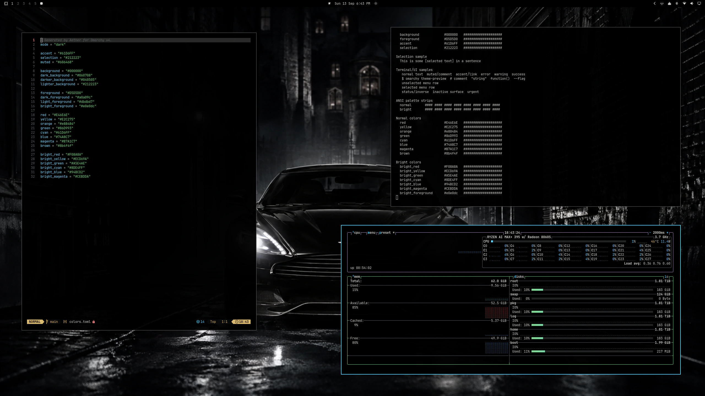

# Omarchy Carbon Black Theme

A carbon-black theme for [Omarchy](https://omarchy.org/), inspired by the incredible Aston Martin Vanquish Carbon Black edition and DHH's [Zonda Zoom](https://github.com/dhh/omarchy-zonda-zoom-theme) Omarchy theme. OLED-friendly pure-black primary surfaces are layered with near-black charcoal, soft gray text, and cool cyan accents.

This is the car the devil himself would drive. If he's not in the Batmobile, Bruce Wayne is in this — darkness and vengeance on four wheels, with menace sculpted into every line.



## Install

Requires Omarchy v4 with `colors.toml` theme support and the `Yaru-blue` icon theme.

```sh
omarchy theme install https://github.com/willspiering/omarchy-carbon-black-theme
```

## Palette

| Role | Hex |
| --- | --- |
| Background | `#000000` |
| Dark background | `#060708` |
| Darker background | `#040505` |
| Lighter background | `#212223` |
| Foreground | `#D5D5D0` |
| Accent | `#61D6FF` |
| Selection | `#212223` |
| Muted | `#606468` |

Full palette in [colors.toml](colors.toml). Icons are `Yaru-blue`.
Omarchy generates application colors from the palette using its built-in templates.

## Shell accents

The included [shell.toml](shell.toml) carries cyan into active and selected
shell states, including toggles, plugin controls, menus, notifications, and
the image picker. User overrides in `~/.config/omarchy/shell.toml` still take
precedence, and the theme does not set shell sizing, spacing, or typography.

## Wallpapers

Eight wallpapers are included in [backgrounds/](backgrounds/): four carbon-black designs and four smoke variants, all at 1672 × 941.

### Animated reveals (Omarchy 4.5+)

All four `carbon-black-cinematic-N.mp4` videos use a 32-second sequence: dark
car, lights switching on, layered moving fog, an extended clear reveal, then
fog returning. Scenes 1, 2, and 4 use headlights; rear-view scene 3 uses red
taillights and diffuse red fog illumination rather than headlight beams.
Each view has its own car silhouette and lamp positions. The lights switch on within
one frame at three seconds and off at 30 seconds once the car is hidden again.
A five-second dark pause spans the loop boundary before they switch on again.
It composites procedural fog over
one locked photograph rather than dissolving between differently drawn cars.
This is a procedural approximation, not a 3D fluid simulation or filmed smoke.
The original four reveal videos remain available for comparison.

Rebuild the cinematic videos with `python3 scripts/render-cinematic.py` after installing
`numpy` and `Pillow` in a Python virtual environment; FFmpeg is also required.
Use `--number 3` to render only the rear view, or repeat `--number` for a subset.

Each numbered smoke image now reveals its matching clear image through a slow,
billowing dissolve: two seconds in shadow, five seconds emerging from the smoke,
then three seconds with the car fully visible. The original images are preserved.

Like Omarchy's stock Catppuccin theme, the four clear wallpapers have matching
one-shot videos in `backgrounds/intros/`. Omarchy plays the matching intro on
login or a theme switch when background intros and animations are enabled, then
settles on the clear still. Cycling still wallpapers does not trigger an intro.
Smoke stills remain static; their matching reveals finish on the clear wallpapers.

Four additional `carbon-black-reveal-N.mp4` wallpapers live directly in
`backgrounds/`. These loop for 20 seconds, revealing the car and then letting the
shadows return. Both ends hold the same smoke image for a seamless repeat.
They appear alongside the stills in Omarchy's background picker/cycle.

Select a loop directly from this checkout:

```sh
omarchy theme bg set "$PWD/backgrounds/carbon-black-cinematic-1.mp4"
```

Videos are silent H.264 MP4, 30 fps, YUV 4:2:0, with fast-start metadata.
Their 1672 × 942 frames preserve every source pixel with one black row added
at the bottom for even video dimensions. No extra wallpaper service or theme
hook is needed; Omarchy 4.5 uses its built-in OWE video support.

Rebuild all videos with Python 3 and FFmpeg (including the `libx264` encoder):

```sh
python3 scripts/render-backgrounds.py
# Or render one variant:
python3 scripts/render-backgrounds.py --number 1 --kind intro
```

Cycle through them with:

```sh
omarchy theme bg next
```
